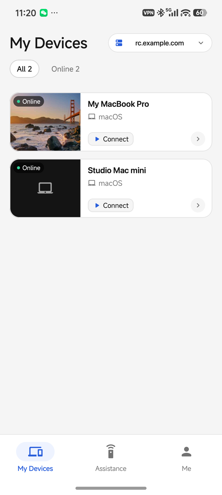
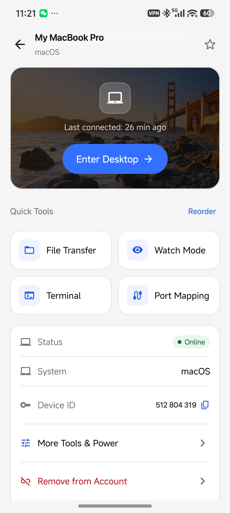
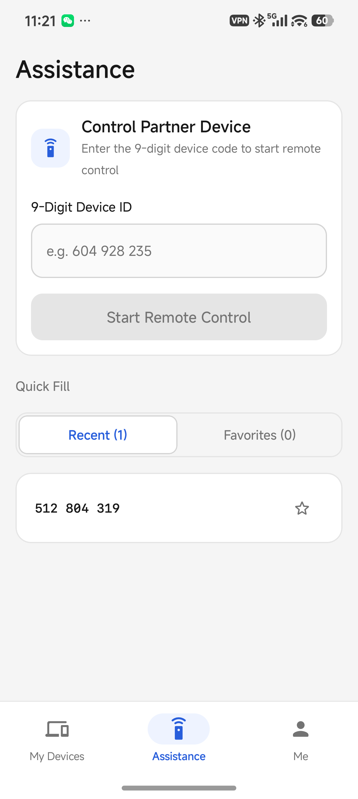
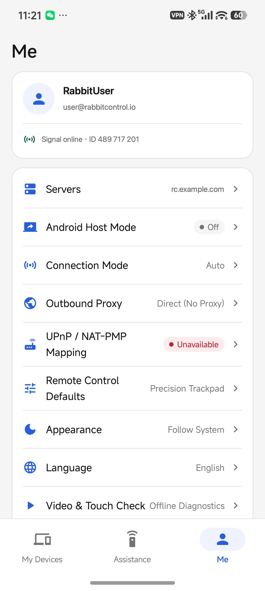
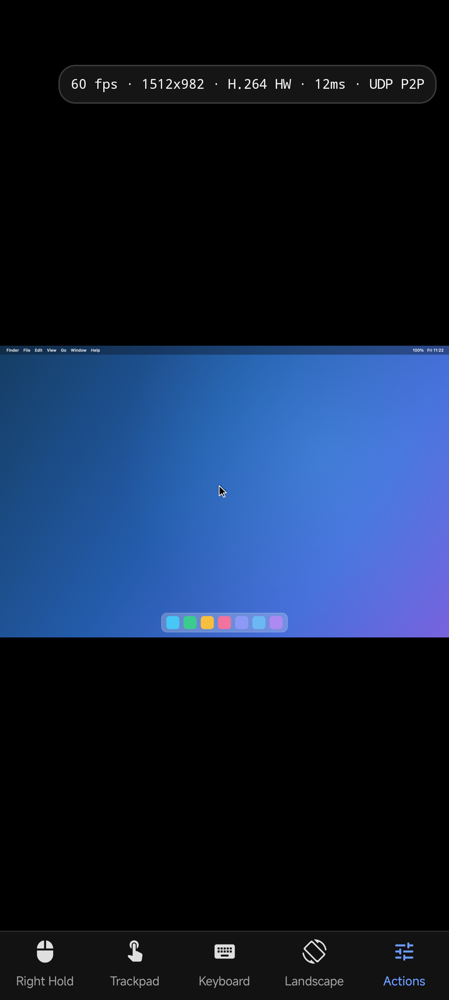
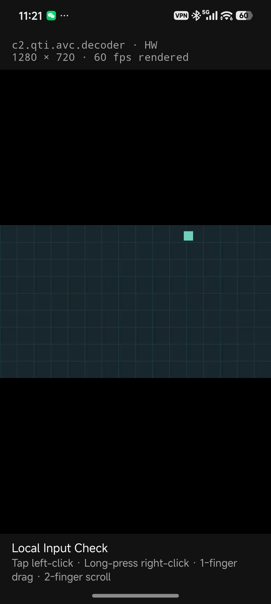
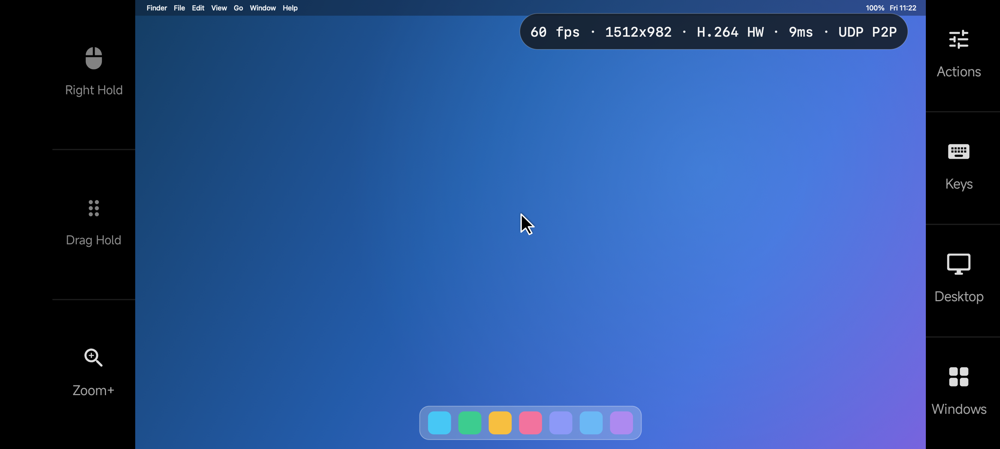

# RabbitControl Android

English | [简体中文](README_zh.md) | [Changelog](CHANGELOG.md)

[](LICENSE)
[-green.svg)](#prerequisites)
[](https://github.com/TokenBoom/rabbitcontrol-core)

The official Android client (and host) for **RabbitControl**, built with **Kotlin + Jetpack Compose (Material 3)** and a **Rust shared core** via JNI.

Powered by [**TokenBoom/rabbitcontrol-core**](https://github.com/TokenBoom/rabbitcontrol-core) for QUIC/mTLS transport, signaling, P2P/relay routing, session state management, input batching, and remote tools.

---

## Screenshots

| Devices | Device Detail & Tools | Remote Assistance |
| :---: | :---: | :---: |
|  |  |  |

| Profile & Settings | Remote Control (Portrait) | Decoder & Touch Verification |
| :---: | :---: | :---: |
|  |  |  |

| Remote Control (Landscape) |
| :---: |
|  |

---

## Features

- **Server Discovery & PKI Verification**: Connect to self-hosted RabbitControl servers (default API port `21118`) with 64-character SHA-256 CA fingerprint verification and dynamic core hot-updates (`core-v*` verified via ECDSA P-256 with automatic rollback).
- **Account & Device Management**: Sign in with RabbitControl credentials, manage bound devices, filter by online status, remove devices, inspect details, and send Wake-on-LAN (WoL) packets.
- **Connection Strategy & Networking**: Configurable connection mode (`Auto` / `P2P Only` / `TCP Relay`) with immediate in-session switching, SOCKS5 / HTTP outbound proxy support, UPnP / NAT-PMP port mapping diagnostics, and automatic network route-change recovery (`NetworkRouteMonitor`).
- **Low-Latency Remote Desktop**:
  - Hardware-accelerated H.264 / HEVC / AV1 video decoding via Android `MediaCodec` / `SurfaceView` with hot-switchable HW/SW decode, live HUD codec telemetry, and High-Refresh Advisory prompts.
  - Multi-display switching and virtual display creation/removal (`DisplaysState`, HiDPI 2x, phone aspect ratio preset).
  - Precision touch layer (`PrecisionTouchLayer`) supporting tap (left-click), long-press (right-click), single-finger drag, two-finger scroll, trackpad/direct modes, full virtual keyboard, desktop key combos, and customizable key-mapping overlay.
- **Privacy, Mute & mTLS Security**: In-session Privacy Curtain (`Off` / `Privacy` / `Black Screen`), Remote Host Mute (auto-restored on disconnect), Android Keystore credential storage, and mTLS peer certificate SHA-256 fingerprint viewer.
- **Remote Tools**: Built-in File Transfer (browse, upload, download, mkdir, rename, delete), ANSI Terminal, and Port Mapping screens backed by `rc-tools` with live host permission enforcement.
- **Android Host Mode & Multi-Language UI**: Screen capture encoding (`MediaProjection` + `HostScreenEncoder`) and input injection (`AccessibilityService`) for sharing the Android screen with live host capability reporting, plus System / English / Simplified Chinese / Traditional Chinese localization.

---

## Architecture & Project Structure

RabbitControl Android splits responsibilities cleanly between Kotlin/Compose and Rust:

- **Kotlin / Jetpack Compose (`app/`)**: UI, navigation, lifecycle, `MediaCodec` surface management, `MotionEvent` gesture handling, and Android system services.
- **Rust JNI Bridge (`native/`)**: Wraps [`TokenBoom/rabbitcontrol-core`](https://github.com/TokenBoom/rabbitcontrol-core) (`rc-client-core`, `rc-session`, `rc-pipeline`, `rc-input`, `rc-audio`, `rc-tools`, etc.) and exposes NDK media/audio and session APIs to Kotlin.

| Path | Responsibility |
| --- | --- |
| [`MainActivity.kt`](app/src/main/java/io/rabbitcontrol/android/MainActivity.kt) | Root Compose navigation, theme management, and session launch |
| [`HomeScreen.kt`](app/src/main/java/io/rabbitcontrol/android/ui/screens/home/HomeScreen.kt) | Main 3-tab UI (Devices, Remote Assistance, Profile) |
| [`DesktopSessionScreen.kt`](app/src/main/java/io/rabbitcontrol/android/ui/session/DesktopSessionScreen.kt) | Remote desktop stage, control panel, keyboard bar, and overlays |
| [`NativeVideoStageView.kt`](app/src/main/java/io/rabbitcontrol/android/core/video/NativeVideoStageView.kt) | `SurfaceView` lifecycle and native video rendering stage |
| [`PrecisionTouchLayer.kt`](app/src/main/java/io/rabbitcontrol/android/core/input/PrecisionTouchLayer.kt) | Touch/trackpad gesture recognition and pointer normalization |
| [`SessionManager.kt`](app/src/main/java/io/rabbitcontrol/android/core/session/SessionManager.kt) | Session lifecycle, state observation, and foreground service bridge |
| [`native/src/lib.rs`](native/src/lib.rs) | Rust JNI entrypoints bridging Kotlin and `rabbitcontrol-core` |
| [`docs/architecture.md`](docs/architecture.md) | Detailed architecture notes and integration design |
| [`docs/ui-design.md`](docs/ui-design.md) | UI design specification, theme tokens, and gesture rules |
| [`docs/core-dynamic-update.md`](docs/core-dynamic-update.md) | Core hot-update architecture, signing, and `core-v*` release guide |
| [`CHANGELOG.md`](CHANGELOG.md) | Release history for APK (`v*`) and core (`core-v*`) updates ([中文](CHANGELOG_zh.md)) |

---

## Build & Run

### Prerequisites

- **JDK 17**
- **Android SDK Platform 36** & **Build Tools 36.0.0**
- **Android NDK 28.2.13676358**
- **Rust (stable)** with `aarch64-linux-android` target
- **cargo-ndk** (`4.1.2`)
- Target device or emulator running **Android 10+ (API 29+)** on **`arm64-v8a`**

### Setup & Build

`native/Cargo.toml` references `rabbitcontrol-core` via a local path dependency (`../rabbitcontrol-core/crates/*`). Clone [`TokenBoom/rabbitcontrol-core`](https://github.com/TokenBoom/rabbitcontrol-core) into the root of this repository before building:

```sh
# 1. Clone the core engine into ./rabbitcontrol-core
git clone https://github.com/TokenBoom/rabbitcontrol-core.git

# 2. Install the Rust Android target and cargo-ndk
rustup target add aarch64-linux-android
cargo install cargo-ndk --version 4.1.2 --locked

# 3. Configure ANDROID_HOME or local.properties, then build the debug APK
./gradlew :app:assembleDebug

# 4. Install on a connected arm64 device or emulator
adb install -r app/build/outputs/apk/debug/app-debug.apk
```

### Tests

```sh
# Run Rust native unit tests (input encoding, fingerprint validation, etc.)
cargo test --locked --manifest-path native/Cargo.toml

# Run Android unit tests
./gradlew :app:testDebugUnitTest
```

---

## Related Projects

- [**TokenBoom/rabbitcontrol-core**](https://github.com/TokenBoom/rabbitcontrol-core) — Cross-platform Rust core engine (protocol, QUIC/mTLS transport, scheduler, media pipeline, session state machine, and tools).

---

## License

This project is licensed under the **GNU Affero General Public License v3.0 (AGPL-3.0)**, consistent with [`TokenBoom/rabbitcontrol-core`](https://github.com/TokenBoom/rabbitcontrol-core). See [LICENSE](LICENSE) for the full license text.
