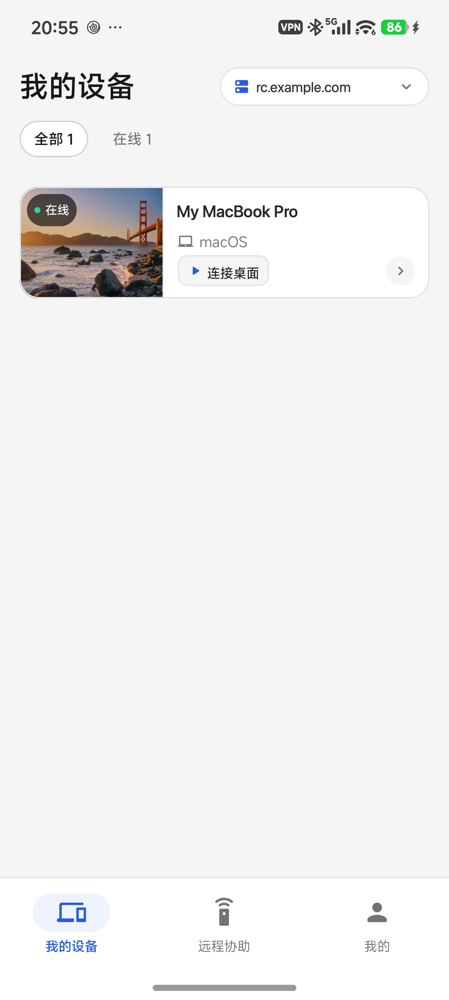
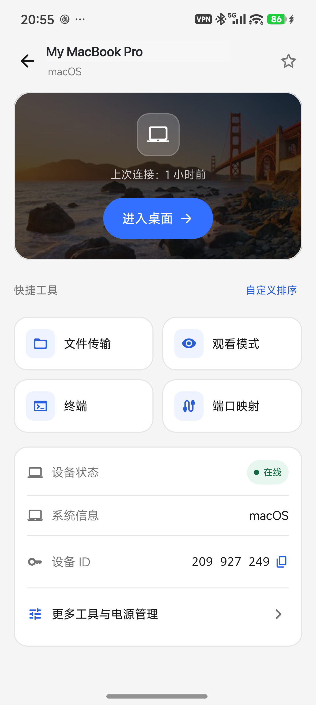
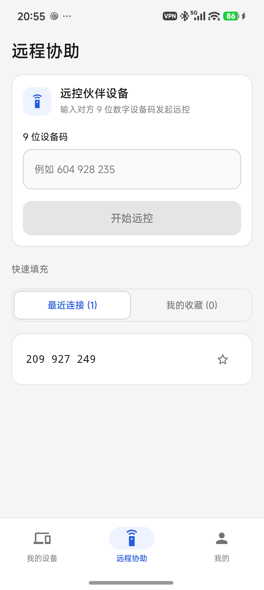
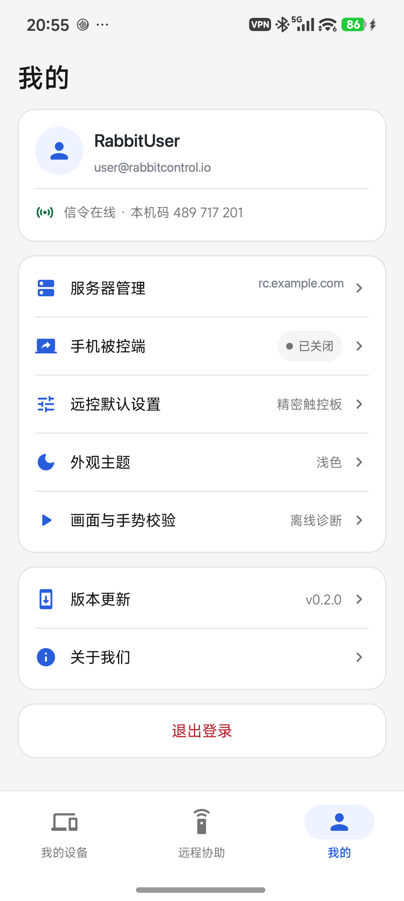
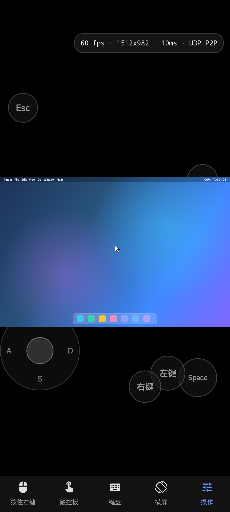
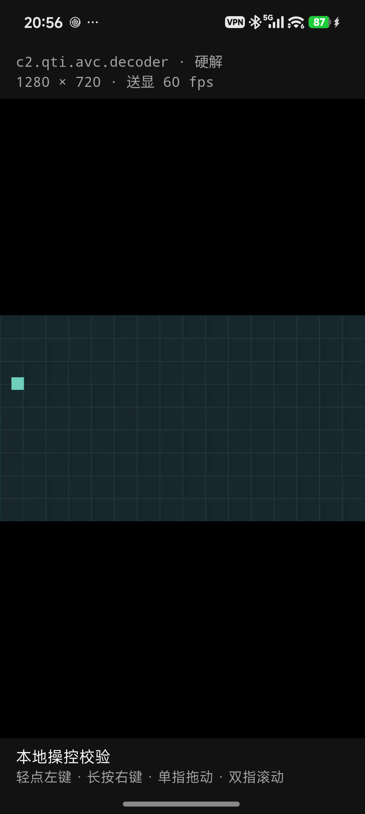
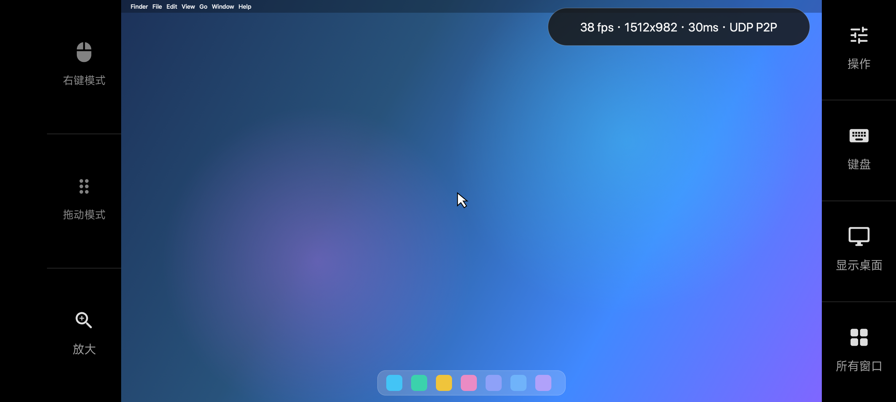

# RabbitControl Android

[English](README.md) | 简体中文

[](LICENSE)
[-green.svg)](#环境要求)
[](https://github.com/TokenBoom/rabbitcontrol-core)

**RabbitControl** 的官方 Android 客户端（同时支持作为被控端），采用 **Kotlin + Jetpack Compose (Material 3)** 与 **Rust 共享内核（JNI）** 构建。

底层核心由 [**TokenBoom/rabbitcontrol-core**](https://github.com/TokenBoom/rabbitcontrol-core) 驱动，提供 QUIC/mTLS 传输、信令、P2P/中继路由、会话状态机、输入批处理与远程工具引擎。

---

## 运行界面

| 我的设备 | 设备详情与快捷工具 | 远程协助 |
| :---: | :---: | :---: |
|  |  |  |

| 个人中心与设置 | 远程控制（竖屏） | 画面解码与手势校验 |
| :---: | :---: | :---: |
|  |  |  |

| 远程控制（横屏） |
| :---: |
|  |

---

## 主要功能

- **服务器发现与 PKI 校验**：支持连接自建 RabbitControl 服务端（默认 API 端口 `21118`），并核对 64 位 SHA-256 CA 指纹。
- **账号与设备管理**：支持 RabbitControl 账号登录、查看已绑定设备列表、按在线状态筛选以及查看设备详情。
- **远程协助**：通过 9 位设备码快速发起连接，支持最近使用记录与常用设备收藏。
- **低延迟远程桌面**：
  - 基于 Android `MediaCodec` / `SurfaceView` 的 H.264 硬件加速解码与低延迟音频播放。
  - 精准触控层（`PrecisionTouchLayer`），支持轻点左键、长按右键、单指拖动、双指滚动、触控板/直触模式、快捷键盘栏与按键映射浮层。
- **远程工具箱**：内置文件传输、ANSI 远程终端与端口映射页面，由 `rc-tools` 提供协议支持。
- **Android 被控端模式**：支持通过 `MediaProjection`（`HostScreenEncoder`）采集编码画面，并通过无障碍服务（`RabbitAccessibilityService`）注入远程输入。
- **安全机制**：凭据与令牌使用 Android Keystore 加密存储；通信链路基于 `rabbitcontrol-core` 的 QUIC + 双向 mTLS 加密。

---

## 架构与目录结构

RabbitControl Android 将界面交互与核心协议清晰分层：

- **Kotlin / Jetpack Compose (`app/`)**：负责 UI 展示、页面导航、生命周期管理、`MediaCodec` 渲染表面、`MotionEvent` 手势识别与系统服务集成。
- **Rust JNI 桥接层 (`native/`)**：封装 [`TokenBoom/rabbitcontrol-core`](https://github.com/TokenBoom/rabbitcontrol-core)（`rc-client-core`、`rc-session`、`rc-pipeline`、`rc-input`、`rc-audio`、`rc-tools` 等），并向 Kotlin 提供 NDK 媒体/音频与会话接口。

| 路径 | 职责 |
| --- | --- |
| [`MainActivity.kt`](app/src/main/java/io/rabbitcontrol/android/MainActivity.kt) | Compose 根导航、主题切换与会话启动入口 |
| [`HomeScreen.kt`](app/src/main/java/io/rabbitcontrol/android/ui/screens/home/HomeScreen.kt) | 主界面三栏导航（设备、远程协助、我的） |
| [`DesktopSessionScreen.kt`](app/src/main/java/io/rabbitcontrol/android/ui/session/DesktopSessionScreen.kt) | 远程桌面会话画面、控制面板、键盘栏与浮层 |
| [`NativeVideoStageView.kt`](app/src/main/java/io/rabbitcontrol/android/core/video/NativeVideoStageView.kt) | `SurfaceView` 生命周期与原生视频渲染舞台 |
| [`PrecisionTouchLayer.kt`](app/src/main/java/io/rabbitcontrol/android/core/input/PrecisionTouchLayer.kt) | 触控/触控板手势识别与坐标归一化 |
| [`SessionManager.kt`](app/src/main/java/io/rabbitcontrol/android/core/session/SessionManager.kt) | 会话生命周期、状态订阅与前台服务桥接 |
| [`native/src/lib.rs`](native/src/lib.rs) | 连接 Kotlin 与 `rabbitcontrol-core` 的 Rust JNI 入口 |
| [`docs/architecture.md`](docs/architecture.md) | 架构设计与端到端集成说明 |
| [`docs/ui-design.md`](docs/ui-design.md) | 界面视觉规范、主题 Token 与手势规则 |

---

## 构建与运行

### 环境要求

- **JDK 17**
- **Android SDK Platform 36** 与 **Build Tools 36.0.0**
- **Android NDK 28.2.13676358**
- **Rust (stable)** 及 `aarch64-linux-android` 编译目标
- **cargo-ndk** (`4.1.2`)
- **Android 10+ (API 29+)** 的 **`arm64-v8a`** 真机或模拟器

### 拉取内核并构建

`native/Cargo.toml` 通过本地路径依赖（`../rabbitcontrol-core/crates/*`）引用内核。构建前请先将 [`TokenBoom/rabbitcontrol-core`](https://github.com/TokenBoom/rabbitcontrol-core) 克隆到本仓库根目录的 `rabbitcontrol-core/`：

```sh
# 1. 克隆核心引擎仓库到 ./rabbitcontrol-core
git clone https://github.com/TokenBoom/rabbitcontrol-core.git

# 2. 安装 Rust Android 目标平台与 cargo-ndk
rustup target add aarch64-linux-android
cargo install cargo-ndk --version 4.1.2 --locked

# 3. 配置 ANDROID_HOME 或 local.properties 后构建 Debug APK
./gradlew :app:assembleDebug

# 4. 安装到已连接的 arm64 设备或模拟器
adb install -r app/build/outputs/apk/debug/app-debug.apk
```

### 运行测试

```sh
# 运行 Rust 原生单元测试（输入编码、指纹格式校验等）
cargo test --locked --manifest-path native/Cargo.toml

# 运行 Android 单元测试
./gradlew :app:testDebugUnitTest
```

---

## 相关项目

- [**TokenBoom/rabbitcontrol-core**](https://github.com/TokenBoom/rabbitcontrol-core) — RabbitControl 跨平台 Rust 核心引擎（共享协议、QUIC/mTLS 传输、调度器、媒体管线、会话状态机与工具引擎）。

---

## 开源协议

本项目采用 **GNU Affero General Public License v3.0 (AGPL-3.0)** 开源协议，与 [`TokenBoom/rabbitcontrol-core`](https://github.com/TokenBoom/rabbitcontrol-core) 保持一致。完整协议文本请参见 [LICENSE](LICENSE)。
